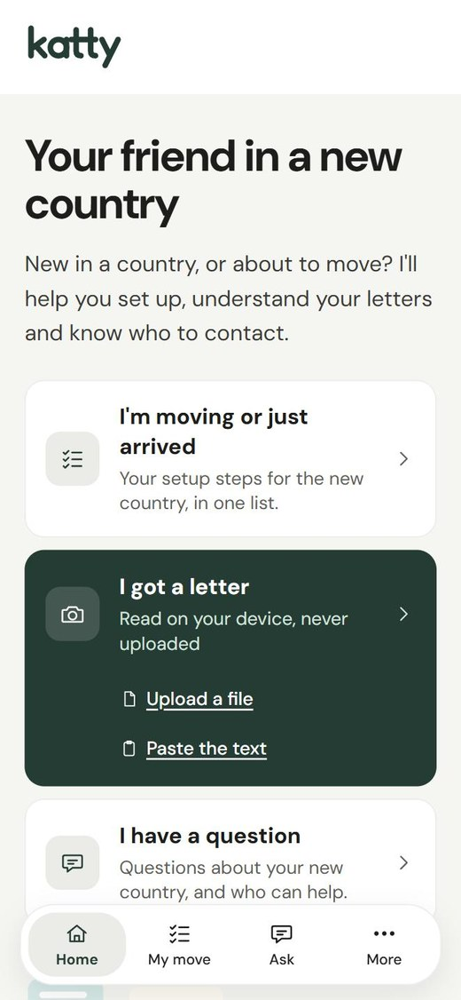
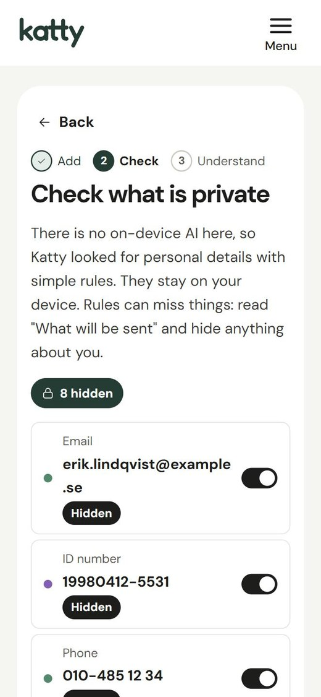

# Katty

Katty is your friend in a new country. It guides you through the setup, explains your official letters without giving away who you are, tells you who to contact, and keeps your move organised, in a language you understand.

<p align="center">
  
  
</p>

Try it: [katty-buddy.web.app](https://katty-buddy.web.app) (desktop Chrome with Gemini Nano for the on-device part).

I have lived in Senegal, France, Sweden and the US, and every move came with forms, numbers and letters I did not fully understand. Katty is the friend I wanted: one who knows the system, never guesses, and never asks for my personal number just to explain a paragraph.

There are three parts:

- My move: You say where you are moving, from where, your citizenship if you want to, and why, and Katty makes a list of the setup steps for that country (registering your address, the personal number, health care, a bank account, the language course) that you can tick off. Only the countries and the reason are sent, nothing else about you. Each step names the authority, and a website is only shown as a link when my code has checked that it is a government address or a well-known non-profit. The list stays in your browser. If Gemini is busy, you can look at an example list I wrote by hand, clearly marked as an example.
- Ask Katty: A chat for questions about the new country. Your question is checked on the device first, so names and numbers are hidden, and you always see exactly what will be sent before it goes. Answers say who can help, with checked links, or a web search that is marked as a search. Katty is told never to give phone numbers, addresses or fees, because those are easy to get wrong, and my code also takes out phone numbers and asks you to check any numbers on the official website. Legal questions, like a refusal or an appeal, get a note to ask a free legal advice service first.
- Letters: Katty reads an official letter and tells you what it means and what to do, as described below.

Katty answers in 55 languages, including Arabic, Persian, Dari, Pashto, Kurdish (Sorani), Hebrew and Urdu written right to left. The screens for 21 of them ship with the app: English, Arabic, Bengali, Chinese, Dari, French, German, Hindi, Kurdish (Sorani), Pashto, Persian, Polish, Portuguese, Russian, Somali, Spanish, Swedish, Tigrinya, Turkish, Ukrainian and Urdu. I made these translations with AI, so they still need a check by native speakers, most of all Somali, Tigrinya, Pashto and Sorani. For the other languages, Gemini translates the screens the first time and the browser keeps that translation.

## How the letter help works

1. You paste a notice.
2. Gemini Nano runs on your own device and lists your personal details (names, ID numbers, addresses, case numbers, phones, emails). My code checks that each one really is in the text, adds pattern checks, and replaces them with labels like `[NAME_1]`. Dates and amounts stay as they are.
3. You see your notice next to what would be shared, hide anything else, and approve.
4. Only the approved text goes to cloud Gemini, which explains what the notice asks of you: what you must do, what you can do and what is unclear. Every point quotes the sentence it comes from, and my code checks that the quote is really in the notice.
5. Deadlines are calculated by the code, not the AI. If a deadline counts from the day you received the letter, Katty asks you for that date.

You can also ask follow-up questions about the notice. Your question is checked on the device first: names and numbers from the notice get the same labels, and new ones are hidden too, so you see what will be sent. Answers come only from the notice. Each answer either quotes the sentence it is based on (checked by the code) or says that the notice does not answer it and offers to start a question to the sender. It does not answer from general knowledge.

Word help explains a word from the approved text, on the device when Gemini Nano can write your language, otherwise in the cloud, and the screen says which. Listen reads the explanation with a voice that runs on your device. My papers keeps saved explanations in your browser only and works the deadlines out again each time you open them.

If the on-device model is not available, nothing is sent anywhere. Katty falls back to the pattern check and lets you hide details yourself.

Katty is not legal advice and does not make you anonymous. It shows you exactly what leaves your device and where every answer comes from.

## Built with

- React and Vite
- Firebase AI Logic with hybrid inference: `ONLY_ON_DEVICE` (Gemini Nano in Chrome) for anything personal, `ONLY_IN_CLOUD` for the approved text
- Firebase App Check
- Firebase Hosting

## Running it locally

You need desktop Chrome with the built-in Prompt API (Gemini Nano). In `chrome://flags`, enable "Prompt API" and restart Chrome.

```
npm install
npm run dev
```

App Check needs a debug token in development. Create `.env.local` with:

```
VITE_APPCHECK_DEBUG_TOKEN=your-debug-token
```

and register the same token in the Firebase console under App Check, Apps, Manage debug tokens.

## Testing the privacy check

The `tools` folder has two small Python scripts:

- `tools/make_test_notices.py` writes made-up notices with known personal details to `public/eval/notices.json`: 30 from templates (Swedish, English and French), 6 I wrote by hand in other layouts and languages, and 8 harder ones (a UK court letter, Dutch, Italian, Canadian, Japanese, Arabic, Spanish and Swedish with a c/o address).
- `tools/score.py` checks the exact text Katty would send. A detail only counts as protected if no part of it is left in that text. It also reports how much of the rest of the letter was kept, so hiding everything would not score well.

Open the app with `?eval` at the end of the address, press "Run the test", download `results.json`, then run `python tools/score.py results.json`.

Without Gemini Nano, a rule-based check looks for numbers, emails, names (after greetings, titles and roles) and home addresses (address blocks, or a street the letter calls your address). Addresses of courts and offices stay visible. On all 44 test letters it now keeps 207 of 208 personal details out of the shared text. That number is flattering: I wrote the rules while looking at these letters. The 8 harder letters were written afterwards, and before I added rules for their formats the check caught 13 of their 21 details. So on devices without Gemini Nano, Katty also asks you to confirm that you read the text before it is sent.

## Translating the screens

The screen texts are in `src/ui-strings.json` (`python tools/extract_strings.py` updates it). The shipped translations are in `public/i18n`; `tools/ship_translation.py` checks that a translation has every text and keeps every placeholder before it writes the file. The remaining languages can be translated once with Google Cloud Translation, if the project has billing:

1. In the Google Cloud console for the Firebase project, turn on the Cloud Translation API (it needs billing).
2. Create an API key that is only allowed to use the Cloud Translation API.
3. Put it in `.env.local` as `GOOGLE_TRANSLATE_API_KEY=...`. It has no `VITE_` prefix, so it never goes into the app.
4. Run `python tools/translate_google.py --dry-run` to see the size, then `python tools/translate_google.py`.

The script skips languages that already have a file, keeps placeholders and names as they are, and leaves a text in English if its placeholders do not come back exactly.

The letter and your personal details are marked `translate="no"`, so a browser's own "Translate this page" does not send them anywhere.

## License

Apache 2.0
